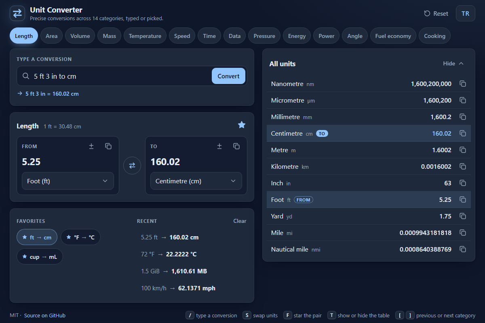

# Unit Converter - fast, precise unit conversions in the browser

[](#tests)
[](LICENSE)

Pick units, or just type “5 ft 3 in to cm”. 14 categories, an English and Turkish
interface, no dependencies and no build step.

**▶ Open the app: https://celaldrg.github.io/unit-converter/**



## Features

- **14 categories, 136 units:** length, area, volume, mass, temperature, speed, time,
  data (decimal and binary prefixes), pressure, energy, power, angle, fuel economy
  (L/100 km, km/L, US and UK mpg) and cooking (spoons, cups, Turkish tea and water glasses).
- **Two linked inputs:** type on either side and the other follows. The side you typed
  keeps full precision, so swapping or changing units never drifts.
- **Smart input line:** `5 ft 3 in to cm`, `72 F in C`, `1 1/2 cups to ml`, `5'3"`,
  `100 km/h -> mph`, or in Turkish `2,5 kg kaç lb`. A live preview shows the answer
  while you type; Enter applies it. Without a target unit it picks a sensible one.
- **All-units table:** the current amount in every unit of the category. Tap a unit
  name to convert to it; every row has a copy button.
- **Favorites and recents:** star up to 12 unit pairs; the last 8 conversions are
  listed too. Both are saved in your browser.
- **Copy buttons** put the plain number on the clipboard, ready to paste.
- **English and Turkish:** the TR/EN button switches every label and the number
  format (`1,610.61` or `1.610,61`), and the choice is remembered.
- Mobile first, dark theme, keyboard friendly, and it honours reduced motion.
- `?demo` opens a fixed showcase state (the one in the screenshot).

## How to use

**Touch or mouse**

- Tap a category chip; on a phone, swipe the row sideways to see them all.
- Type a number in **From** or **To** and choose the units below each box.
- **±** next to an amount flips its sign, for phone number pads without a minus key.
- The round button between the boxes swaps the units; the star saves the pair.
- Tap a favorite or a recent entry to open it again; **Clear** empties the recents.
- In the table, tap a unit name to convert to it; **Hide** / **Show** folds the table.
- **Reset** returns to 1 in the category's default units; **TR** / **EN** switches the language.

**Keyboard**

| Key | Action |
| --- | --- |
| `/` | Jump to the smart input line |
| `Enter` | Convert the smart line, or save the amount you typed to the recents |
| `Esc` | Clear the smart line (while it has focus) |
| `S` | Swap the units |
| `F` | Star or un-star the pair |
| `T` | Show or hide the all-units table |
| `[` and `]` | Previous or next category |
| Arrow keys, `Home`, `End` | Move between categories when a chip has focus |

Single-key shortcuts are off while you are typing in a field. `Tab` reaches every control.

## Run locally

The app uses ES modules, which browsers do not load from `file://`, so serve the
folder over `http://`:

```sh
npx serve .
```

Then open the address it prints (for example http://localhost:3000). Any static file
server works; there is nothing to install or build.

## Tests

```sh
node --test
```

The suites use the built-in `node:test` runner (Node.js 20 or newer) and cover the
unit data, conversions, number parsing and formatting, the smart-line parser, the
converter model, the interface labels, keyboard shortcuts, storage and the page
markup. GitHub Actions runs them on every push and pull request.

## Project structure

```
index.html          page skeleton, meta tags and favicon
style.css           dark, mobile-first styles
src/
  units.js          the 14 categories and 136 units (data)
  convert.js        conversions through each category's base unit
  numbers.js        number parsing and formatting, English and Turkish
  lookup.js         finds units by symbol or name, ignoring case and accents
  parser.js         the smart input line ("5 ft 3 in to cm")
  model.js          converter state: linked inputs, query, table, favorites, recents
  i18n.js           interface strings in English and Turkish
  labels.js         interface text built from the unit data
  shortcuts.js      keyboard shortcuts and category stepping
  storage.js        the only place that touches localStorage
  view.js           draws the state into the page
  main.js           wires every control to the model
  dom.js, icons.js  a small element builder and the SVG icons
  clipboard.js      copy to the clipboard, with a fallback
  dragscroll.js     mouse drag scrolling for the category row
test/               node:test suites
docs/screenshot.png
```

## License

[MIT](LICENSE) © 2026 Celalettin Durgaç

---

## Türkçe

Tarayıcıda çalışan hızlı ve hassas bir birim çevirici. Birimleri seçin ya da
doğrudan “2,5 kg kaç lb” yazın. Türkçe ve İngilizce arayüz; bağımlılık ve derleme adımı yok.

**▶ Uygulamayı aç: https://celaldrg.github.io/unit-converter/**

### Özellikler

- **14 kategori, 136 birim:** uzunluk, alan, hacim, kütle, sıcaklık, hız, zaman,
  veri (ondalık ve ikili önekler), basınç, enerji, güç, açı, yakıt tüketimi
  (L/100 km, km/L, ABD ve İngiliz mpg) ve mutfak (kaşık, su bardağı, çay bardağı, cup).
- **Birbirine bağlı iki kutu:** hangisine yazarsanız öteki güncellenir. Yazdığınız
  taraf tam hassasiyette tutulur; birimleri değiştirmek ya da yer değiştirmek sayıyı kaydırmaz.
- **Akıllı satır:** `2,5 kg kaç lb`, `72 F kaç C`, `5 ft 3 in to cm`, `1 1/2 cups to ml`,
  `100 km/h -> mph`. Yazarken sonuç önizlenir, Enter uygular. Hedef birim yazılmazsa
  uygun bir birim seçilir.
- **Tüm birimler tablosu:** girilen miktar, kategorideki her birimde. Bir birimin
  adına dokununca ona çevrilir; her satırda kopyalama düğmesi var.
- **Favoriler ve son çevirmeler:** en çok 12 birim çiftini yıldızlayın; son 8 çevirme
  de listelenir. İkisi de tarayıcınızda saklanır.
- **Kopyalama düğmeleri** sayıyı yapıştırmaya hazır, sade biçimde panoya koyar.
- **Türkçe ve İngilizce:** EN/TR düğmesi bütün yazıları ve sayı biçimini (`1.610,61`
  ya da `1,610.61`) değiştirir; seçim hatırlanır.
- Önce mobil, koyu tema, klavyeyle tam kullanım; azaltılmış hareket ayarına uyar.
- `?demo` sabit tanıtım görünümünü açar (ekran görüntüsündeki).

### Nasıl kullanılır

**Dokunmatik ya da fare**

- Bir kategori düğmesine dokunun; telefonda hepsini görmek için satırı yana kaydırın.
- **Kaynak** ya da **Hedef** kutusuna sayı yazın, birimleri altlarındaki listeden seçin.
- Miktarın yanındaki **±** düğmesi sayının işaretini değiştirir; eksi tuşu olmayan telefon tuş takımları için.
- İki kutu arasındaki yuvarlak düğme birimlerin yerini değiştirir; yıldız çifti kaydeder.
- Bir favoriye ya da son çevirmeye dokununca yeniden açılır; **Temizle** son çevirmeleri siler.
- Tabloda bir birimin adına dokununca ona çevrilir; **Gizle** / **Göster** tabloyu katlar.
- **Sıfırla** kategorinin varsayılan birimlerinde 1'e döner; **EN** / **TR** dili değiştirir.

**Klavye**

| Tuş | İşlev |
| --- | --- |
| `/` | Akıllı satıra geç |
| `Enter` | Akıllı satırı çevir ya da yazdığınız miktarı son çevirmelere ekle |
| `Esc` | Akıllı satırı temizle (odaktayken) |
| `S` | Birimlerin yerini değiştir |
| `F` | Çifti yıldızla ya da yıldızı kaldır |
| `T` | Tabloyu aç ya da kapat |
| `[` ve `]` | Önceki ya da sonraki kategori |
| Ok tuşları, `Home`, `End` | Odak bir kategori düğmesindeyken kategoriler arasında gez |

Bir kutuya yazarken tek tuşlu kısayollar çalışmaz. `Tab` her denetime ulaşır.

### Yerelde çalıştırma

Uygulama ES modülleri kullanır; tarayıcılar bunları `file://` üzerinden yüklemez.
Klasörü `http://` ile sunun:

```sh
npx serve .
```

Sonra yazdırdığı adresi açın (örneğin http://localhost:3000). Herhangi bir statik dosya
sunucusu da olur; kurulacak ya da derlenecek bir şey yok.

### Testler

```sh
node --test
```

Testler Node.js'in yerleşik `node:test` çalıştırıcısını kullanır (Node.js 20 ve üstü):
birim verisi, çevirmeler, sayı okuma ve biçimleme, akıllı satır ayrıştırıcısı, çevirici
modeli, arayüz yazıları, klavye kısayolları, depolama ve sayfa yapısı. GitHub Actions
her push ve pull request'te testleri çalıştırır.

### Lisans

[MIT](LICENSE) © 2026 Celalettin Durgaç
